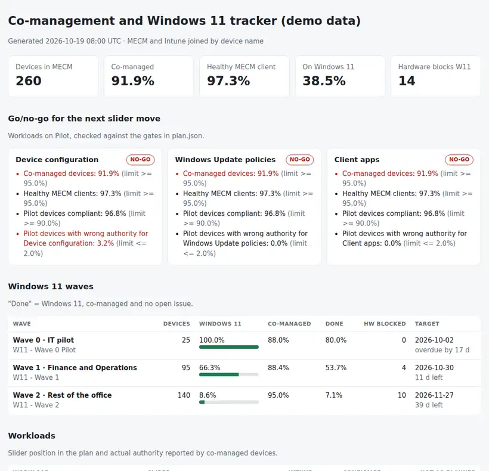

# MECM + Intune Co-management Tracker

A weekly view of a **co-management** and **Windows 11** migration. It joins the Configuration Manager (MECM) estate with Intune, shows which devices are really co-managed, which workload each device takes from Intune versus what the plan says, how each Windows 11 wave is going, and whether the next **workload slider move** passes agreed go/no-go gates.

Python 3.10+, standard library only. A read-only SQL query for the MECM side and a PowerShell export for Intune (Microsoft Graph). Runs with fictional demo data out of the box.



## Why

During a co-management migration, the questions in every status meeting are the same:

- How many devices are actually co-managed, and why are the others not?
- If we move *Device configuration* to Intune for everyone tomorrow, what breaks?
- Is wave 2 going to finish on time, and which devices cannot run Windows 11 at all?

The answers live in two consoles that do not talk to each other in a report: MECM knows collections, client health and OS builds; Intune knows enrolment, compliance and which workloads it manages on each device. This tool puts both in one page and adds the one thing neither console gives you: a **go/no-go** for the next step, based on numbers agreed in advance.

## What it does

| | |
|---|---|
| Join | MECM and Intune records matched by device name (case and DNS suffix ignored). States: **Co-managed**, **MECM only (not enrolled)**, **Enrolled, not co-managed**, **In MECM, no client**, **Intune only** (for example Autopilot devices). Duplicate Intune records from re-enrolments are collapsed to the newest. |
| Workloads | For each co-managed device, the expected authority per workload (from the slider and pilot collection in `plan.json`) against the actual flag Intune reports (`configurationManagerClientEnabledFeatures`). |
| Health | MECM client inactive or without a recent policy request, no recent Intune sync, Intune non-compliance. |
| Windows 11 | Share per wave, hardware that blocks the upgrade, "done" share (Windows 11, co-managed, no open issue) and days to the wave's target date. |
| Gates | For every workload on *Pilot*: co-managed share, healthy clients, pilot compliance and pilot devices with the wrong authority, against the limits in `plan.json`. |
| Outputs | `report.html` (single file, light and dark mode), `exceptions.csv` (one row per device issue, with the next step), `gates.md` (a go/no-go note to paste into the change request). |

How it fits into a migration with a change board: [docs/rollout-playbook.md](docs/rollout-playbook.md).

## Try it

```bash
git clone https://github.com/inigogonzalezgarcia/18-mecm-intune-comanagement-tracker.git
cd 18-mecm-intune-comanagement-tracker
python -m comgmt demo
```

Open `output/report.html` and `output/gates.md`.

The demo is a made-up company with 260 Windows devices in three waves, halfway through the migration. *Compliance policies* and *Resource access* are already on Intune; *Device configuration*, *Windows Update* and *Client apps* are on Pilot. The gates say **NO-GO** for all three: only 91.9 % of devices are co-managed (11 never enrolled, 7 enrolled outside co-management, 3 without a client), and one pilot device has not picked up the *Device configuration* change. The IT pilot wave is also 17 days past its target.

## Use it with your own environment

1. **MECM side.** Edit the collection names in [`scripts/mecm_devices.sql`](scripts/mecm_devices.sql), run it read-only against the site database and save the result as `mecm_devices.csv`. The Windows 11 hardware readiness column has to come from your own source (see the note at the end of the query).
2. **Intune side.** Read-only, scope `DeviceManagementManagedDevices.Read.All`:
   ```powershell
   Install-Module Microsoft.Graph.Authentication -Scope CurrentUser   # once
   .\scripts\Export-IntuneComanagement.ps1 -OutputPath .\intune_devices.json
   ```
3. **Plan.** Copy `sample_data/plan.json` and set your pilot collection, slider positions (`configmgr`, `pilot`, `intune`), waves and gates.
4. **Report:**
   ```bash
   python -m comgmt report mecm_devices.csv intune_devices.json --plan plan.json
   ```
   Options: `--out output`, `--now 2026-10-19T08:00:00Z`, `--title "Madrid · W11"`.

The exports contain device names and serial numbers. Keep them, and the reports, inside your organisation. Real exports are excluded from Git by `.gitignore`.

## Tests

```bash
python -m unittest discover tests      # or: pip install -r requirements-dev.txt && python -m pytest
```

14 tests: every join state, name matching, the slider logic, authority mismatches, client and sync health, Windows 11 blocking, the gates (go and no-go), wave progress, duplicate and non-Windows records in the Intune export, plan validation and the demo end to end.

**What has not been tested yet:** the SQL query against a real site database (view and column names follow the documented reporting views, but versions differ) and the PowerShell export against a real tenant.

## Roadmap

- Keep weekly snapshots and draw the trend per wave.
- Match by serial number or Entra device ID when names are reused.
- Add the Endpoint analytics Windows 11 readiness data instead of a manual column.
- Link with project 02 (Intune compliance report) for the compliance detail of each exception.

## Background

Built from my work packaging applications with SCCM, managing devices with Intune and leading the Windows 11 migration of an office, where most of the effort was not the upgrade itself but finding the devices that were not where the plan said they were. The co-management workload model follows Microsoft's documentation. Written from scratch with fictional data; no employer code, data or configuration is used.

## Customisation and contact

Want this adapted to your migration (your collections and waves, other gates, a scheduled weekly report, matching on serial numbers)? Get in touch:

- Website (contact form): [inigogonzalezgarcia.github.io](https://inigogonzalezgarcia.github.io/about.html#contacto)
- LinkedIn: [linkedin.com/in/igonzalez93](https://www.linkedin.com/in/igonzalez93)

## License

MIT
